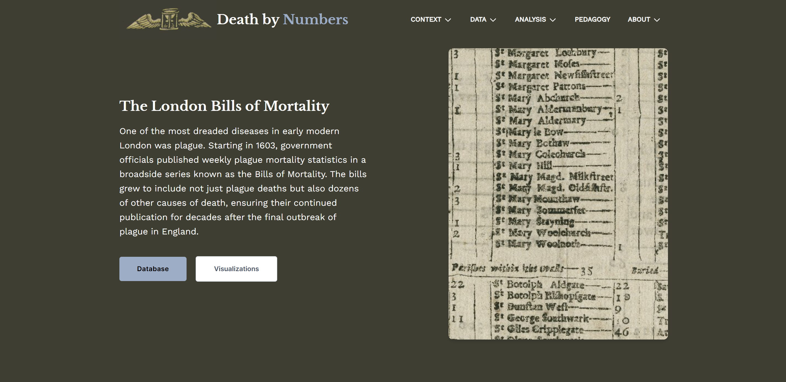

<strong>Project Description: </strong> 
Death by Numbers studies the Bills of Mortality, 17th century broadsides which published plague deaths in London. This project transcribed and published the information in these bills in a dataset for computational analysis.
I worked on this project as a transcriber in the Fall of 2023. During this time, I also published a blog post titled <a target="_blank" href="https://deathbynumbers.org/analysis/2023-11-27-old-bailey-bills/">Comparing the Bills of Mortality and Old Bailey Proceedings</a>. In the spring of 2024, I rejoined the project and contributed to preliminary data visualizations, built with the JavaScript libraries Observable Plot and d3.js.  

<strong>Collaborators: </strong>
* Jessica Otis, George Mason University
* Jason Heppler, Roy Rosenzweig Center for History and New Media

<strong>Link: </strong> https://deathbynumbers.org/  