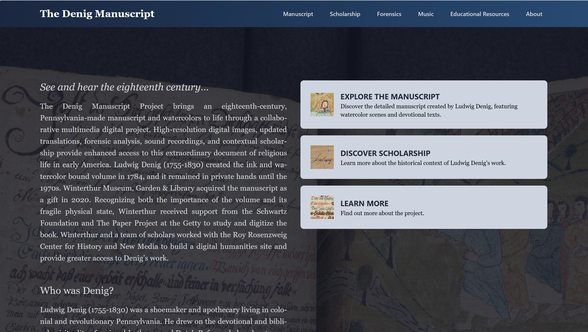

<strong>Project Description: </strong> 
<i>The Denig Manuscript</i> explores the manuscript and watercolor paintings of Ludwig Denig (1755-1830), a shoemaker and apothecary living in Pennsylvania during the colonial and revolutionary eras. This website allows users to explore Denig's manuscript through a variety of ways: high resolution digital images, forensic report, music recordings, scholarly essays, and teaching materials. The document provides a window into the religious and cultural life of early Aemrica.

In 2024, I contributed to <i>The Denig Manuscript</i> as a junior developer. 

<strong>Collaborators: </strong>
- Roy Rosenzweig Center for History and New Media
- Winterthur Museum, Garden & Library

<strong>Link: </strong> <a target="_blank" href="https://denigmanuscript.org/">The Denig Manuscript</a> 