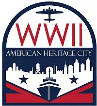

<strong>Project Description: </strong> 
The American World War II Heritage Cities Program is a National Parks Service iniative that recognizes the contributions of everyday Americans to the homefront effort during World War II. Each state and territory can nominate one city or county for designation. The program highlights the how the war's impact on the cities and their populations, and creates educational material about the World War II homefront. 

In the summer of 2024, I interned with the American World War II Heritage Cities Program. My main task was constructing an interactive map to showcase the designated cities. After collecting open-source shapefiles of the cities, I created the spatial data layer using ArcGIS. I then used ArcGIS Experience Builder to build an interactive interface, combining the spatial data, city data, photographs, and brief descriptions of each city. 

<strong>Collaborators: </strong> National Parks Service 

<strong>Link: </strong> <a target="_blank" href="https://www.nps.gov/subjects/worldwarii/americanheritagecity.htm">American World War II Heritage Cities</a>