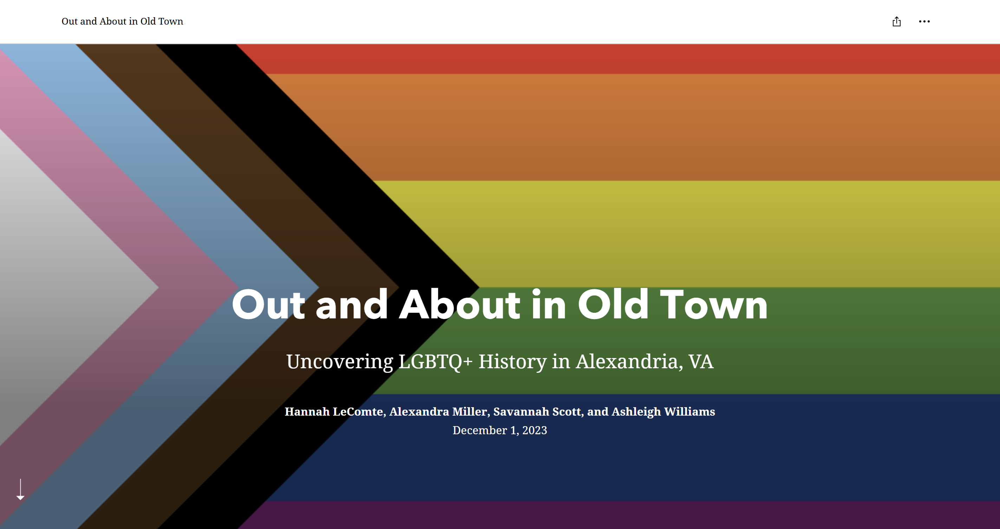

<strong>Project Description: </strong> 
This project explores local queer history in Northern Virginia. 

It began as a class project in the Fall 2023 as a digital walking tour exploring sites of queer history in Alexandria, VA, with ArcGIS Storymaps. The project received support from the Alexandria Historical Society and the Roy Rosenzweig Center for History and New Media to expand inquiry into Northern Virginia. 

We are currently researching and building a website for the expanded content.

<strong>Collaborators: </strong> Hannah LeComte, Alexandra Miller, and Ashleigh Williams

<strong>Link: </strong> https://storymaps.arcgis.com/stories/c1bf986aba7a43cd8811e03591414a66 