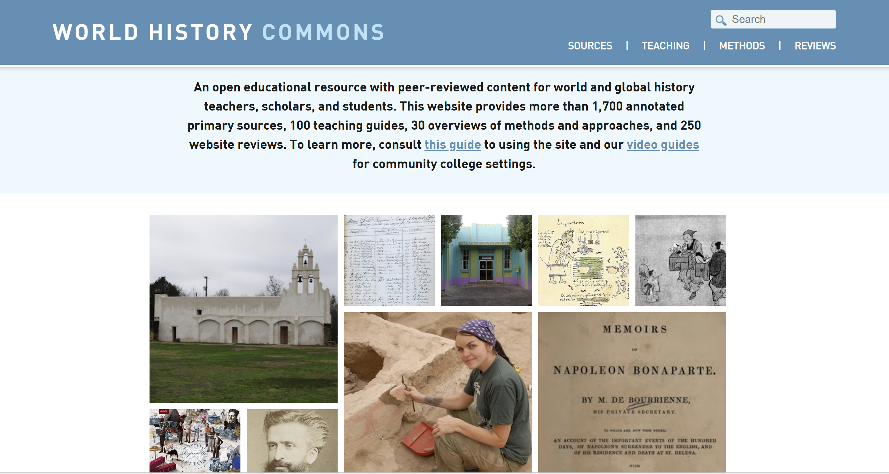

<strong>Project Description: </strong> 
World History Commons is an open-access, peer-reviewed educational resoruce for teachers. Its content focuses on world history teaching guides and primary sources. As a research assistant during the Fall of 2023, I reviewed websites and annotated primary sources. The website reviews accessed the pedagogical potential of the site, and how an educator could use it in their classroom. Similarly, primary source annotations focused on finding accessible digital sources, and providing brief context for them. This project aims to support world history teachers through accessible and usable material.

<strong>Collaborators: </strong> Dr. Nate Sleeter, Roy Rosenzweig Center for History and New Media

<strong>Link: </strong> <a target="_blank" href="https://worldhistorycommons.org/search/node?keys=savannah+scott">My contributions to World History Commons</a>